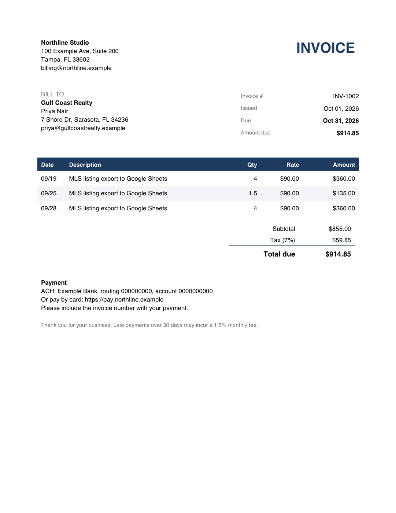

# Invoice generator: CSV to PDF invoices

Takes a month of billable work (a CSV export from a time tracker, a
spreadsheet, or a bookkeeping tool) and produces one PDF invoice per client
plus an Excel register of everything that was billed.



## What it does

- Groups work by client, numbers invoices sequentially
- Per-client payment terms and sales tax rate
- Money math in `Decimal` with half-up rounding, so totals match the accountant's
- Clean US Letter PDF: bill-to block, line items, subtotal, tax, due date, payment info
- `register_YYYY-MM.xlsx`: invoice list with totals row, ready for follow-up on unpaid ones
- Fails loudly on a work row with an unknown client instead of silently dropping it

## Run

```bash
pip install -r requirements.txt
python invoices.py --month 2026-09 --issued 2026-10-01
pytest
```

Input files live in `sample_data/` (`work_log.csv`, `clients.csv`, `company.json`).
All companies in the sample data are fictional.

## Easy extensions

Email each PDF to the client through Gmail/SMTP, pull the work log straight from
Google Sheets or QuickBooks, add a logo, or mark invoices paid from a bank CSV.
